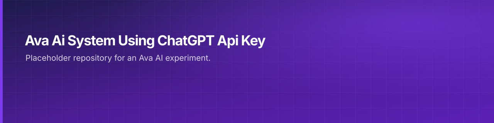

 

---

## What this is

Source project. Also checked in: 1 markdown document. The sections below are read from the repository itself, 1 tracked files as of 2024-01-21.

|  |
|:--:|
| **1** |
| docs |

---

<a href="https://github.com/gowtham-creator/Ava-Ai-system-using-ChatGPT-Api-Key">gowtham-creator/Ava-Ai-system-using-ChatGPT-Api-Key</a>

